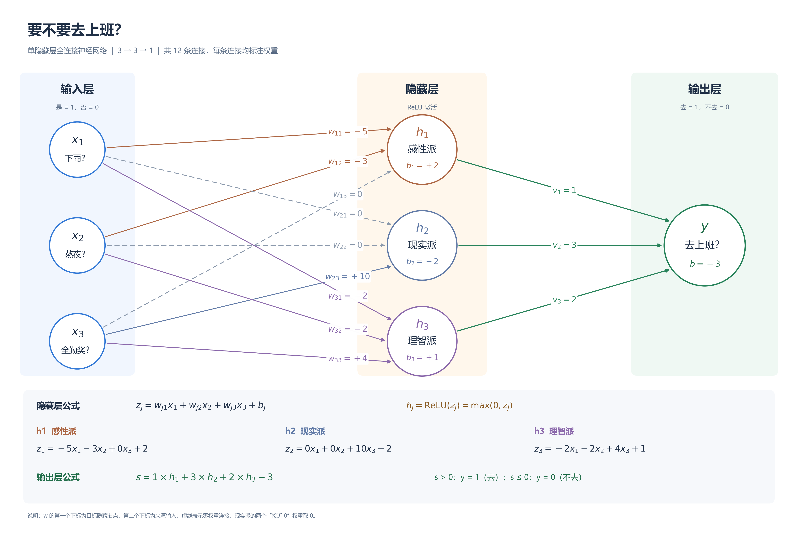
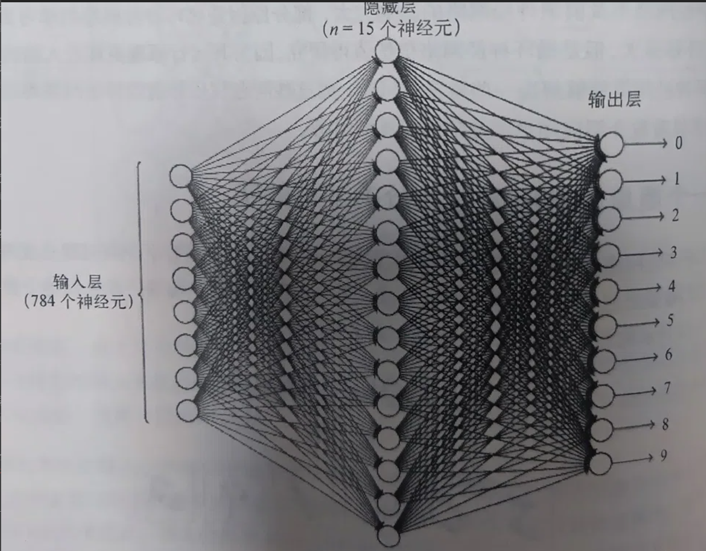

# 全连接神经网络的理解

## 一、是否上班案例



---

把结构简化为**一层隐藏层**（输入层 → 隐藏层 → 输出层），这是最经典、最好理解的神经网络结构。

还是用“要不要去上班”来举例。假设你每天早上醒来，大脑都在跑一个神经网络。

为了更直观，设计如下：

- **输入层（3个节点）**：收集客观信息。
- **隐藏层（3个节点）**：三个性格不同的“决策参与者”，各自用不同的权重和偏置对同一组输入做出中间判断。
- **输出层（1个节点）**：最终决定（去=1，不去=0）。

---

### 第一层：输入层（信息输入）

假设你只考虑 3 个因素（3个节点）：

- $x_1$：**今天下雨了吗？**（下=1，不下=0）
- $x_2$：**昨晚熬夜了吗？**（熬了=1，没熬=0）
- $x_3$：**今天有全勤奖吗？**（有=1，没有=0）

这 3 个节点不做任何决策，它们只是把最原始的输入信息传给下一层。

---

### 第二层：隐藏层（三个性格不同的人）

这一层有 3 个节点，可以理解为三个**性格不同的人**。他们看到的是同一组输入（下雨、熬夜、全勤奖），但因为各自的权重和偏置不同，所以会做出不同的中间判断。

**1. 节点 h1（感性派）**

- **性格**：极度讨厌下雨，也很怕累，完全不在乎钱。
- **连接权重**：从 $x_1$（下雨）来的权重是 **-5**；从 $x_2$（熬夜）来的权重是 **-3**；从 $x_3$（全勤奖）来的权重是 **0**。
- **偏置**：2（天生有点想偷懒）。
- **计算与激活**：$z = -5x_1 - 3x_2 + 0x_3 + 2$。
  - 如果今天下雨且熬夜（$x_1=1, x_2=1$），得分是 -6，小于0。经过 ReLU 激活函数后输出 **0**，也就是“完全不想动”。
  - 如果今天没下雨没熬夜（$x_1=0, x_2=0$），得分是 2，大于0，激活后输出 **2**。

**2. 节点 h2（现实派）**

- **性格**：完全不在乎天气和疲劳，只在乎钱，给钱就有动力。
- **连接权重**：从 $x_3$（全勤奖）来的权重是 **+10**；其他输入权重接近 0。
- **偏置**：-2（对上班本身没什么热情）。
- **计算与激活**：如果今天有全勤奖（$x_3=1$），算出 8 分，激活输出；如果没有（$x_3=0$），算出 -2 分，低于0，输出0。

**3. 节点 h3（理智派）**

- **性格**：综合考量，既看天气和疲劳，也看奖金，做事比较平衡。
- **连接权重**：下雨权重 -2，熬夜权重 -2，全勤奖权重 +4。
- **偏置**：1。
- **计算与激活**：把所有客观因素做一次综合权衡，再经过激活函数输出。

这三个隐藏节点就是三个**性格不同的人**：感性派 h1 主要对“下雨和疲劳”反应强烈，现实派 h2 主要对“全勤奖”反应强烈，理智派 h3 则做一个综合权衡。他们看到的是同一组输入，但给出的中间判断各不相同。

---

### 第三层：输出层（最终决策）

输出层只有 1 个节点，也就是“最终的你”。它接收隐藏层三个人传来的判断，并对他们的意见赋予不同的**信任程度（权重）**：

- 对感性派 h1 的权重是 **1**。
- 对现实派 h2 的权重是 **3**。
- 对理智派 h3 的权重是 **2**。
- 偏置是 **-3**（你总体上是个比较自律、倾向去上班的人）。

**最终计算**：最终得分 = $1 \times h_1 + 3 \times h_2 + 2 \times h_3 - 3$。

如果最后算出来的总分大于0，经过激活函数，输出 **1（去上班）**；如果小于0，输出 **0（请假）**。

---

### “为什么这么多连线？”

因为**上一层的每一个节点，都要把信号传给下一层的每一个节点**。

- 输入层有 3 个节点，隐藏层有 3 个节点，它们之间就有 $3 \times 3 = 9$ 根连线。每根连线上的权重表示某个输入对某个“人”的重要程度。
- 隐藏层 3 个节点，输出层 1 个节点，它们之间就有 $3 \times 1 = 3$ 根连线，表示你对这三个人的信任程度。

### 为什么要隐藏层？

如果没有隐藏层，直接拿天气、熬夜、奖金来算最终决定，模型就只能做简单的线性判断，这叫“单层感知机”。

**有了隐藏层，相当于有了感性派、现实派、理智派这三个性格不同的人先各自做出中间判断，再由你做最终决策。** 网络不再只是直接看原始数据，而是先让不同“性格”的节点提取出不同的中间特征，再基于这些特征做最终决定。这就是神经网络表达能力更强的原因。

而所谓的**“训练神经网络”**，就是用你过去几百天“去/没去上班”的记录，去**自动调整这些连线上的权重 $w$ 和节点里的偏置 $b$**，直到这个网络算出的结果，尽量符合你真实的决策习惯。

---

## 二、手写数字识别案例



假设我们现在有一个已经训练好的神经网络，它的任务就是：**看一张 $28 \times 28$ 的图片，判断它是 0~9 里的哪个数字。**

这个网络的结构就是你书上图 1-20 的样子：**输入层（784个圈） → 隐藏层（15个圈） → 输出层（10个圈）**。

我们以输入一张手写的数字 **“0”** 为例，看看这一路是怎么走过来的：

---

### 第一层：输入层（784个情报员）

*   **对应结构**：784个圆圈。
*   **在这个案例里**：一张图片有 $28 \times 28 = 784$ 个像素点。每个圈就负责接收一个像素点的信息。
    *   如果这个像素是黑色的，圈就收到 1（或者 0~1 之间的灰度值）。
    *   如果这个像素是白色的，圈就收到 0。
*   **它的作用**：这 784 个圈没有任何思想，它们只是把这张图片的原始样子，原封不动地通过密密麻麻的连线，传递给下一层。

---

### 第二层：隐藏层（15个特征检测员）

*   **对应结构**：15个圆圈。
*   **在这个案例里**：这就是书里**图 1-22** 提到的概念。这 15 个圈就像是 15 个“找茬专家”，它们不认完整的数字，只认**局部的碎片形状**。
    *   假设第 1 个圈专门找“左上角的弧线”。
    *   第 2 个圈专门找“右上角的弧线”。
    *   第 3 个圈专门找“中间的一条竖线”。
    *   ...等等。

**它的计算过程是怎样的？**

这 15 个圈，每个圈都会拿到输入层的 784 个像素。但是，每个圈手里有一本“权重账本”（连线上的数字）：

*   当图片传进来时，第 1 个圈（左上角专家）只给图片左上角的像素分配很高的权重（比如 +5），给其他区域的像素分配 0 或者负权重。
*   它算了一下总分：左上角刚好有一道弧线，得分很高。经过**激活函数**，它大喊一声：“我找到了！左上角有弧线！”（输出高分）。
*   同理，第 2、3... 个专家也各自判断，有没有找到自己负责的零件。没找到的，就保持沉默（输出 0）。

---

### 第三层：输出层（10个最终裁判）

*   **对应结构**：10个圆圈（分别代表数字 0、1、2、3、4、5、6、7、8、9）。
*   **在这个案例里**：这 10 个圈是最终的决策者。它们不再直接看 784 个原始像素，而是看着下面 15 个专家的汇报。

**它的计算过程是怎样的？**

这 10 个裁判，每个人都有自己的“偏好权重”：

*   **裁判“0”**：它给“左上角弧线”、“右上角弧线”、“左下角弧线”、“右下角弧线”这四个专家分配了极高的权重。
*   **裁判“1”**：它只给“中间竖线”和“右上角折线”的专家分配高权重。
*   **裁判“8”**：它给左右两边的圈圈专家分配高权重。

**最终发生什么？**

因为输入的确实是数字“0”，那几个负责“四周弧线”的专家疯狂激活（输出高分）。裁判“0”收到了这些高分，一加权算总分，得分极高（比如 9.8 分）。

裁判“1”和“8”因为没收到它们想要的信号，得分很低（比如 0.1 分）。

于是，**裁判“0”被彻底激活**，网络最终输出：**“这张图片是数字 0！”**

---

### 总结：为什么要有“隐藏层”？

如果没有隐藏层，输入层的 784 个像素直接连到输出层，会发生什么？

*   裁判“0”需要死记硬背：第 1 个像素、第 2 个像素、第 35 个像素……必须是黑色，才能是 0。只要手写字稍微歪了一点，裁判“0”就不认识了。

**有了隐藏层（专家）后：**

*   网络学会了**拆分问题**：先找线条、找弧线（隐藏层），再把弧线拼成完整的数字（输出层）。
*   这样，哪怕你写的“0”很胖、很瘦、或者有点歪，只要那四条弧线还在，隐藏层专家就能把它们找出来，输出层依然能认出它是 0。

这就是神经网络通过**“层级特征提取”**来识别手写数字的完整过程。

---

## 三、隐藏层对不同部位检测的理解

要理解“隐藏层神经元负责检测不同部位”，我们需要把宏观的“形状”拆解成微观的“数字”，看看它是怎么通过 $w$（权重）和 $b$（偏置）算出来的。

为了让你看得很透彻，我们**不用 784 个像素那么多**，我们把图片简化成一个 **$3 \times 3$ 的九宫格（9个像素）**。

假设：黑色像素是 1，白色像素是 0。

现在我们要让隐藏层的**第1个神经元（代号：左上角弧线检测员）**来工作。

---

### 1. 直观理解：它凭什么只“检测特定部位”？

因为“全连接”意味着这 9 个像素都会连线到它。但是！**连线的权重（$w$）是它自己调的（或者说训练出来的）。**

这个“左上角检测员”非常有个性（其实是我们通过训练让它的权重变成了这样）：

*   它给**左上角、上中、左中**这三个位置分配的权重是 **正数**（比如 +1，代表“我非常看重你们”）。
*   它给**其余所有位置**（比如右下角、中下）分配的权重是 **0 或负数**（代表“我根本不关心你们”）。

### 2. 对应的计算过程（数学实战）

假设现在输入了一张图片（左上角有一条弧线），像素点如下：

```text
[1, 1, 0]  <- 第一行
[1, 0, 0]  <- 第二行
[0, 0, 0]  <- 第三行
```

这个神经元的具体参数如下：

*   **权重 $w$**：
    *   左上角的线：$w_1 = 1.0$
    *   上边中间的线：$w_2 = 1.0$
    *   左边中间的线：$w_3 = 1.0$
    *   其他所有位置（比如中间、右下角）的线：$w = 0$
*   **偏置 $b$**：**-1.5**。（偏置就像是一个门槛，意味着如果输入的特征不够明显，总分就会低于0，无法激活）。

#### 第一步：线性计算（加权求和 $z = wx + b$）

它把这 9 个像素全部乘上对应的权重加起来：

*   左上角像素(1) $\times 1.0 = 1.0$
*   上中像素(1) $\times 1.0 = 1.0$
*   左中像素(1) $\times 1.0 = 1.0$
*   其他像素(0) $\times 0 = 0$
*   总和：$1.0 + 1.0 + 1.0 = 3.0$

加上偏置 $b = -1.5$：

**最终得分 $z = 3.0 - 1.5 = 1.5$**

#### 第二步：过激活函数（比如 ReLU）

ReLU 函数说：“大于 0 的数原样输出，小于 0 的变成 0”。

因为 $z = 1.5 > 0$，所以这个神经元的**输出 $a = 1.5$**。

**结论：这个神经元“激活”了！它向下一层大喊：“我看到左上角的弧线了！”**

---

### 3. 如果输入的不是“0”呢？

假设现在输入的是数字“1”，图片是这样的：

```text
[0, 0, 0]
[0, 1, 0]  <- 只有中间有像素
[0, 0, 0]
```

- 左上角检测员再次计算：中间那个像素虽然亮着，但因为它给中间分配的权重是 **0**，所以带不来任何分数。
- 得分 $z = 0 - 1.5 = -1.5$。
- 过激活函数，因为 $-1.5 < 0$，直接变成 **0**。
- **结论：这个神经元“沉默”了。它报告：“我没看到左上角的弧线。”**

---

### 💡 核心总结

1.  **为什么叫“检测特定部位”？** 因为**权重决定了它眼睛往哪看**。如果连线上的权重把其他区域全标成了 0，这个神经元实际上就在“管中窥豹”，只盯着局部几个像素。
2.  **计算过程是怎样的？** 就是把你关心的那几个像素乘以一个大权重，加上偏置（门槛）算总分。如果总分大于 0（过激活函数），就代表那个特征被找到了。

**在实际的神经网络中（图1-20）：**

有 15 个隐藏层神经元，它们各自的参数（权重和偏置）一开始是随机的。在学习（训练）的过程中，网络发现：有的神经元把权重调整成了“只看左上角弧线”，有的调整成了“只看右侧竖线”，有的调整成了“只看底部的横线”……最终，这 15 个“瞎子摸象”的检测员，把它们各自看到的局部特征汇总，就能完美拼凑出数字 0 到 9 的完整形状了。

---

## 四、什么是激活函数

**激活函数（Activation Function）就是一个“数字质检员”。它决定了上一个神经元算出来的分数，到底要不要传给下一层，或者要以什么形式传下去。**

---

### 1. 激活函数到底在做什么？

之前看的感知机里，计算过程永远是两步：

1.  **线性计算（搬运工）**：算总分 $z = wx + b$。
2.  **非线性变换（质检员）**：把算出来的 $z$ 塞进激活函数 $f(z)$ 里，得到最终的输出 $a = f(z)$。

这个“质检员”有个规矩：**它接手的输入（$z$）是任意大小的数字，但它输出的结果必须被限制在某个范围里，或者进行某种扭曲。** 只有经过质检员盖章（激活函数处理）的数字，才有资格通过连线，传给下一层的神经元。

### 2. 常见的激活函数长什么样？

*   **阶跃函数（你图1-5用的）**：最严格的门卫。
    *   规则：分数大于等于 0，直接放行输出 1；分数小于 0，直接毙掉输出 0。
    *   特点：就像开关一样，非黑即白。
*   **Sigmoid 函数**：温柔的压缩器。
    *   规则：不管输入多大或多小，它都会把结果死死压缩在 **0 到 1 之间**（适合当概率用）。
    *   比如你算出 100 分，它输出 0.999；算出 -50 分，它输出 0.0001。
*   **ReLU 函数（现代神经网络的最爱）**：最现实的势利眼。
    *   规则：**大于 0 的，原样保留；小于 0 的，统统变成 0**。
    *   也就是我们前面举例的：算出 8 就输出 8，算出 -3 就输出 0。

### 3. 为什么非它不可？

如果没有这个质检员，网络会变成什么样？我们打两个最直观的比方：

**比方一：不给任何门槛的流水线**

如果没有激活函数，就相当于所有机器算出来的分数，不管是正数还是负数，直接就塞给下一层。最后网络只会做纯粹的乘法和加法。在数学上，这就是个一次函数（直线），画在图上就是一条死板的直线，永远没法解决弯弯绕绕的现实问题。

**比方二：没有神经阈值的生物**

在生物学中，神经元要接收到足够强的刺激，才会“放电”传递信号。激活函数就是在模拟这种“放电”机制：

*   如果刺激不够（算出来负数），神经元就沉默（ReLU输出 0）。
*   如果刺激够强（算出来正数），神经元就兴奋，把信号传给下一个人。

### 总结

*   **没有激活函数**：神经网络就是个计算器，只会做 $wx+b$。
*   **有了激活函数**：神经网络就有了“非线性”能力。它能把原本笔直的数据空间**揉捏、折叠、扭曲**，从而能够拟合世间万物复杂的规律（比如识别猫、听懂语音）。

这就是为什么你说“没有激活函数不行”——因为没有它，哪怕你画了 1000 层，这个网络在数学上也就只是一个圆圈的“单层感知机”罢了。

---

## 五、为什么要激活函数

**如果没有激活函数，你画再复杂的神经网络，叠100层、1000层，它本质上就等价于只有一层（一个圈）。**

从数学、几何和实际应用三个层面来看：

### 1. 数学层面：底层逻辑“折叠”了

假设你有一个没有激活函数的网络，有两层：

*   **第一层**：$y_1 = w_1 x + b_1$
*   **第二层**：$y_2 = w_2 y_1 + b_2$

你把第一层的式子代入第二层：

$$
y_2 = w_2 (w_1 x + b_1) + b_2
$$

$$
y_2 = (w_2 w_1)x + (w_2 b_1 + b_2)
$$

你看，无论 $w$ 和 $b$ 是多少，$(w_2 w_1)$ 永远是个常数，$(w_2 b_1 + b_2)$ 也永远是个常数。

所以，它最终依然是一个类似 $y = Wx + B$ 的**直线方程**。

如果你继续加第三层、第四层，最后的结果依然是一条直线。**你辛辛苦苦画了这么多圈和连线，相当于白干了，因为数学上它和一个圈的感知机一模一样。**

### 2. 几何层面：你想画曲线，却只能用直尺

真实世界的问题（比如识别猫、预测股票）极其复杂，数据分布是弯弯曲曲的，根本无法用一条直线完美分开。

*   **没有激活函数**：就好比你手里只有一把**直尺**，无论你叠加多少把直尺，你也只能画出一条直线。
*   **有激活函数**：激活函数（比如 ReLU 把负数变成 0）就像是一个“折叠”操作。它可以把原本平滑的直线掰弯，产生**折角**。有了折角，你就可以用无数短折线拼出极其复杂的曲线，从而拟合真实的复杂世界。

### 3. 实际例子：著名的“异或（XOR）问题”

回到你书里前面的例子：

*   输入 (0, 0) 输出 0
*   输入 (1, 1) 输出 0
*   输入 (1, 0) 输出 1
*   输入 (0, 1) 输出 1

如果你在纸上画一下这四个点，你会发现，**你永远不可能用一条直线把“输出1”和“输出0”的这两拨点分开**。如果只用线性计算（没有激活函数），哪怕你叠了一万层网络，它也是在找一条直线，它永远解不出这个最简单的异或问题。

但是，只要你加一个激活函数（比如你书里图1-5那个把负数变0的阶跃函数），这条直线在数学空间里就被“扭曲”了，一扭，就能完美解决异或问题了。

---

### 总结打个比方：

*   **全连接层（$wx+b$）**：是网络里的“搬运工”，负责把不同的信息加权汇总。但如果只有搬运工，网络就只会把东西直直地搬来搬去，毫无变化。
*   **激活函数**：是网络里的“魔术师”。它会在每一层做一次“非线性扭曲”，把空间揉捏、折叠、变形。正是因为有了这种扭曲，多层神经网络的“深度”才真正有了意义，它才能处理图像、语音、语言这些极其复杂的非线性问题。

---

## 六、梯度下降

### 符号指南（阅读前必看）

*   **$\Delta$（读作 Delta）**：代表**“微小的变化量”**。比如 $\Delta x$ 就是“$x$ 稍微改变了一点点”，$\Delta C$ 就是“误差稍微改变了一点点”。
*   **$\partial$（读作 Partial / 偏导符号）**：代表**“只关注一个变量，其他全当死数字”**时的变化率（偏导数）。
*   **$\nabla$（读作 Nabla）**：代表**“梯度”**。它其实就是把所有的偏导数（$\partial$）打包成的一个**向量（箭头）**。

---

### 第一阶段：微观溯源——为什么 $y=ax$ 的导数是 $a$？（基础微积分）

在进入神经网络之前，我们必须先弄明白微积分中最核心的**导数定义公式**：

**导数 = （$y$ 的变化量 $\Delta y$）除以（$x$ 的变化量 $\Delta x$）**

假设我们有一个最基础的线性函数：$y = a \cdot x$。

我们让 $x$ 稍微增加一个极小的量，记作 $\Delta x$。那么新的 $y$ 就是：

$$
y_{\text{新}} = a \cdot (x + \Delta x)
$$

现在我们来算 $y$ 到底变了多少（即 $\Delta y$）：

$$
\Delta y = y_{\text{新}} - y_{\text{旧}}
= a(x + \Delta x) - ax
= ax + a\Delta x - ax
= a\Delta x
$$

接着，我们把 $y$ 的变化量除以 $x$ 的变化量，求“变化率”：

$$
\frac{\Delta y}{\Delta x} = \frac{a\Delta x}{\Delta x} = a
$$

**结论：** 无论那个微小扰动 $\Delta x$ 是多少，结果永远是系数 $a$。这就是为什么求导时，系数会原封不动地保留下来。

---

### 第二阶段：微观计算——这根线到底有多大“责任”？（偏导数）

带着上面的结论，回到神经网络。在识别手写数字“0”时，网络认错了，误差是 $C$。我们想知道：**“如果我把第 $j$ 根连线 $w_j$ 稍微改一点，误差 $C$ 会跟着变多少？”** 这就是求偏导数 **$\dfrac{\partial C}{\partial w_j}$**。

> **解释 $\partial$**：为什么不用 $\Delta$ 而用 $\partial$？因为误差 $C$ 受成千上万个参数影响。偏导数 $\partial$ 的意思是：**“现在我假定世界上只有 $w_j$ 这一个变量，其他所有的参数全当常数看”**。

根据**链式法则**，分两步：

#### 第一步：$w_j$ 怎么影响神经元总分 $z$？

加权求和公式：

$$
z = w_1x_1 + w_2x_2 + \dots + w_jx_j + \dots + b
$$

对 $w_j$ 求偏导时，其他 $w$、所有的输入 $x$、偏置 $b$ 全被当成死板的常数。公式就变成了：$z = \text{常数} + x_j \cdot w_j$。

这就回到了我们第一阶段的 $y = a \cdot x$ 形式（这里系数 $a$ 就是 $x_j$）。所以：

$$
\frac{\partial z}{\partial w_j} = x_j
$$

> **物理意义**：权重 $w_j$ 对总分的影响力，完全取决于传进来的信号 $x_j$ 有多大。$x_j=0$ 时毫无影响；$x_j=10$ 时，稍微动一下 $w_j$，总分就会剧变。

#### 第二步：总分 $z$ 怎么影响最终误差 $C$？

这部分经过激活函数和损失函数，记为 $\dfrac{\partial C}{\partial z}$。

**乘起来（链式法则）：**

$$
\frac{\partial C}{\partial w_j} = \frac{\partial C}{\partial z} \cdot \frac{\partial z}{\partial w_j} = \frac{\partial C}{\partial z} \cdot x_j
$$

---

### 第三阶段：宏观组合——梯度是个什么“鬼”？（$\nabla$ 的登场）

网络里有成千上万个参数。把所有参数对误差的偏导数排成一个列表（向量），这就是**梯度（$\nabla C$）**：

$$
\nabla C = \left( \frac{\partial C}{\partial v_1}, \frac{\partial C}{\partial v_2}, \dots \right)^T
$$

> **解释 $\nabla$**：你可以把它当成一个**打包盒**。上面算出来的都是针对某个具体连线的偏导，用 $\nabla$ 打包后，它就变成了一个指向高维空间的**箭头**。
> **微积分定理**：这个箭头，**永远指向误差 $C$ 增加最快的方向（上坡最陡的方向）**。我们要下山，就必须朝它的反方向走。

---

### 第四阶段：数学证明——凭什么朝反方向走，误差一定变小？

**1. 误差变化近似（全微分）**

假设准备迈出一个微小的步子 $\Delta v$。高度（误差）的变化 $\Delta C$ 近似为两个向量的乘积：

$$
\Delta C \approx \nabla C \cdot \Delta v
$$

**2. 设定下降规则**

为了让 $\Delta C < 0$（下山），设定步子方向与梯度相反（引入步长 $\eta$）：

$$
\Delta v = - \eta \nabla C
$$

**3. 终极代入证明**

$$
\Delta C \approx \nabla C \cdot (-\eta \nabla C)
$$

$$
\Delta C \approx -\eta (\nabla C \cdot \nabla C)
$$

$$
\Delta C \approx -\eta \|\nabla C\|^2
$$

**数学铁证：** $\|\nabla C\|^2$ 必定 $\ge 0$，$\eta$ 是正数，所以 $-\eta \|\nabla C\|^2$ **必定是负数**。只要按这个规则走，误差 $C$ 绝对会下降。

---

### 第五阶段：落地执行——最终公式出炉

新位置 = 老位置 + 步子（$\Delta v$）：

$$
v_{\text{新}} = v_{\text{老}} + \Delta v
$$

代入 $\Delta v$：

$$
v_{\text{新}} = v_{\text{老}} - \eta \nabla C
$$

对应到具体的一根权重连线 $w_j$ 上：

$$
w_j^{\text{新}} = w_j^{\text{老}} - \eta \frac{\partial C}{\partial w_j}
$$

*(代码里就是 `w = w - learning_rate * gradient`)*

---

### 第六阶段：实战循环（手写数字识别全流程）

1.  **前向传播**：输入“0”，网络错认成“8”，误差 $C = 100$。
2.  **反向传播（求导）**：通过第一阶段的微积分定义，系统算出“左上角弧线”传出的信号极强（$x_j=5$），算出了它对应的偏导数 $\dfrac{\partial C}{\partial w_j} = 10$（这根线闯大祸了）。
3.  **更新参数**：设定学习率 $\eta=0.1$，套用公式：

$$
w_j = w_j - 0.1 \times 10 = w_j - 1
$$

权重被调小。

4.  **循环**：重新前向传播，误差降到 80。再算偏导数、再减梯度……
5.  几万次循环后，所有参数滚落到谷底，网络学会识别数字。

---

### 第七阶段：深度答疑——为什么高度变化是“梯度点乘步子”？

很多人在看到 $\Delta C \approx \nabla C \cdot \Delta v$ 时，都会产生一个巨大的困惑：“高度变化不就是 $C_{\text{终点}} - C_{\text{起点}}$ 吗？凭什么等于**梯度（一个方向）乘上距离（另一个方向）**？”

要想直观理解这个公式，我们需要在脑海里建立一个**“在平地上行走”**的画面。

#### 1. 物理课的类比：做功

想想物理公式：**做功 = 力 × 距离**。如果你斜着拉箱子，真正起作用的只是力在水平方向的分量：**做功 = （力在前进方向的分量） × 移动的距离**。

在数学上，这就叫**点乘（内积）**：$\Delta W = \vec{F} \cdot \Delta \vec{s}$。

在这里，“力”就是梯度，“位移”就是步子，点乘出来的结果就是高度变化。

#### 2. 一维直线下的理解（你的直觉）

设 $C = kv + b$（一条直线，$k$ 是斜率）。取两点 $v_1, v_2$，那么：

$$
\Delta C = C(v_2) - C(v_1) = k(v_2 - v_1) = k \cdot \Delta v
$$

这里的 $k$ 相当于一维的梯度，$\Delta v$ 是步子。在一维里，梯度、割线斜率、导数是一回事。所以你的公式 $\Delta C = \dfrac{\Delta y}{\Delta x} \cdot \Delta x$ 在直线下是完全成立的。

#### 3. 推广到多维：点积与方向的投影

假设你在二维平面爬山，高度公式是 $C = k_1 v_1 + k_2 v_2 + b$。

*   梯度是 $\nabla C = (k_1, k_2)$（指向最陡的上坡方向）。
*   你走了一步，步子向量是 $\Delta v = (\Delta v_1, \Delta v_2)$。

此时高度变化是多少？

$$
\Delta C = k_1 \Delta v_1 + k_2 \Delta v_2 = (k_1, k_2) \cdot (\Delta v_1, \Delta v_2)
$$

**这就是点积！** 它的几何意义是：

$$
\Delta C \approx \|\nabla C\| \cdot \|\Delta v\| \cdot \cos\theta
$$

（$\theta$ 是梯度方向和步子方向的夹角）。

*   **如果顺着梯度走**（$\theta=0$），$\cos\theta=1$，高度上升最快。
*   **如果逆着梯度走**（$\theta=180^\circ$），$\cos\theta=-1$，高度下降最快（这就是梯度下降）。
*   **如果横着走**（$\theta=90^\circ$），$\cos\theta=0$，高度不变（点积结果为0）。

**所以，点乘的真正含义是：“你实际迈出的这一步，其中有多少是顺着最陡方向走的？”** 顺着最陡方向走的投影长度，乘上坡度（梯度大小），就是你高度的变化量。

#### 4. 为什么非线性时要写“约等于（$\approx$）”？

在直线（线性函数）下，梯度处处相等，上述等式是**精确成立**的。

但当 $C$ 不是直线（比如神经网络复杂的非线性误差曲面）时，梯度是**不断变化**的。你迈出一步之后，脚下的坡度可能就变了。因此，只有当你迈出的步子 $\Delta v$ **足够小**时，$\nabla C \cdot \Delta v$ 才能算作对高度变化的**一阶近似**。这就是公式里写 $\approx$ 的原因。

---

# 七、深度学习底层核心代码解析

假设我们的网络结构是 `net = Network([784, 30, 10])`，输入一张写着数字“0”的图片。

## 第一步：初始化网络 (`__init__`) —— 搭建骨架

```python
class Network(object):
    def __init__(self, sizes):
        self.num_layers = len(sizes) # sizes = [784, 30, 10]，所以是 3 层
        self.sizes = sizes
        
        # 初始化偏置 b：生成均值为0，标准差为1的随机数
        self.biases = [np.random.randn(y, 1) for y in sizes[1:]]
        
        # 初始化权重 w：生成随机矩阵
        self.weights = [np.random.randn(y, x) for x, y in zip(sizes[:-1], sizes[1:])]
```

### 🔍 重点拆解：这两行天书一样的代码到底干了啥？

**1. 拆解 `self.biases`（偏置）：**

*   **切片 `sizes[1:]`**：取的是 `[30, 10]`（跳过输入层，因为输入层只接收数据，不需要偏置）。
*   **循环生成**：`biases[0]` 形状 **(30, 1)**，代表隐藏层30个神经元的初始偏置；`biases[1]` 形状 **(10, 1)**，代表输出层10个神经元的初始偏置。

**2. 拆解 `self.weights`（权重，用到 `zip` 魔法）：**

*   `zip` 把 `[784, 30]`（前一层）和 `[30, 10]`（后一层）一对一咬合。
*   **循环生成**：`weights[0]` 形状 **(30, 784)**，代表输入层到隐藏层的连线；`weights[1]` 形状 **(10, 30)**，代表隐藏层到输出层的连线。

---

## 第二步：前向传播 (`feedforward`) —— 得出预测

```python
    def feedforward(self, a):
        # a 是输入的图片数据 (784, 1)
        for b, w in zip(self.biases, self.weights):
            a = sigmoid(np.dot(w, a) + b) 
        return a
```

### 📊 详细数据举例：

1.  **输入 `a`**：一张图的 784 个像素，比如 `[[0.0], [0.0], [0.9], ..., [0.0]]`。
2.  **第一次循环（隐藏层）**：`w (30, 784)` 乘以 `a (784, 1)` 得到 `(30, 1)`，加上偏置 `b`，过 `sigmoid`。输出 `a` 变成 `(30, 1)`。
3.  **第二次循环（输出层）**：`w (10, 30)` 乘以刚才的 `(30, 1)`，加上偏置 `b`，过 `sigmoid`。
4.  **最终输出**：返回 `(10, 1)` 的向量，比如 `[[0.01], [0.02], [0.95], [0.00], ...]`。（网络瞎猜，觉得有95%的概率是数字2）。

---

## 第三步：核心引擎，反向传播求梯度 (`backprop`) —— 追责大会

这一步分两半：**先存证据，后算责任。**

```python
    def backprop(self, x, y):
        nabla_b = [np.zeros(b.shape) for b in self.biases] # 准备空容器装责任
        nabla_w = [np.zeros(w.shape) for w in self.weights] # 准备空容器装责任
        
        # ==========================================
        # 【第一段 for 循环：前馈并保存证据】
        # ==========================================
        activation = x
        activations = [x] 
        zs = [] 
        for b, w in zip(self.biases, self.weights):
            z = np.dot(w, activation) + b
            zs.append(z)                     # 【存证据1】把没激活的总分 z 存起来
            activation = sigmoid(z)
            activations.append(activation)   # 【存证据2】把激活后的输出 a 存起来
```

### 🔍 第一个 for 循环深入解析：为什么要存证据？

因为一会儿要用微积分的链式法则“追究责任”，必须用到前向传播的数据。

*   `zs` 列表存下了：隐藏层总分 `(30, 1)`，输出层总分 `(10, 1)`。
*   `activations` 列表存下了：输入像素 `(784, 1)`，隐藏层输出 `(30, 1)`，输出层预测 `(10, 1)`。

```python
        # ==========================================
        # 【抓首犯：算输出层的误差和责任】
        # ==========================================
        delta = self.cost_derivative(activations[-1], y) * sigmoid_prime(zs[-1])
        
        nabla_b[-1] = delta
        nabla_w[-1] = np.dot(delta, activations[-2].transpose())
```

### 📊 数据举例与严格概念澄清：

*   **算误差 `delta`**：用预测值减去真实标签，再乘导数。得到一个 **(10, 1)** 的列向量，代表输出层 10 个神经元**各自的“责任书”**。

> **💡 严格数学概念澄清（易错点）：**
> 准确地说，`delta` 代表的是**误差关于神经元“总分 $z$”的偏导数**（数学符号是 $\dfrac{\partial C}{\partial z}$）。
> 而真正的**“梯度”**，是指误差关于**权重 $w$ 和偏置 $b$** 的偏导数。
> *   **对于偏置 $b$**：它的梯度恰好就等于 `delta` （代码里直接写了 `nabla_b[-1] = delta`）。
> *   **对于权重 $w$**：`delta` 并不等于权重梯度。权重的梯度 = `delta` 乘以输入信号 $a$ （即代码里的 `np.dot(delta, activations[-2].transpose())`）。

*   **算权重梯度 `nabla_w[-1]`**：用 `(10, 1)` 的误差，乘以刚才存的隐藏层输出 `(30, 1)` 的转置 `(1, 30)`。得到一个 **(10, 30)** 的矩阵。代表连接隐藏层和输出层的这 300 根线**每一根的错**。

```python
        # ==========================================
        # 【第二段 for 循环：顺藤摸瓜，追责隐藏层】
        # ==========================================
        for l in range(2, self.num_layers):
            z = zs[-l]
            sp = sigmoid_prime(z)
            
            # 核心：把后一层的误差，按连线的粗细（权重）反向分配回来！
            delta = np.dot(self.weights[-l+1].transpose(), delta) * sp
            
            nabla_b[-l] = delta
            nabla_w[-l] = np.dot(delta, activations[-l-1].transpose())
            
        return (nabla_b, nabla_w)
```

### 🔍 第二个 for 循环深入解析：怎么追责隐藏层？

网络 3 层，`range(2, 3)` 只循环一次（`l = 2`）。

*   **分配责任**：输出层说“我是因为隐藏层给信号不对才错的！”。`self.weights[-1].transpose()` 拿到 `(10, 30)` 权重矩阵的转置 `(30, 10)`。
*   `np.dot(权重转置, 输出层误差)`：**连线越粗（权重越大），隐藏层分到的责任越大。** 算出一个 **(30, 1)** 的向量。
*   `* sp`：乘上隐藏层自身的导数。如果它之前已经很确信，导数接近0，责任就变小。
*   **算隐藏层连线的梯度**：用刚算出的 `(30, 1)` 责任，乘以一开始存的输入层像素 `(784, 1)` 的转置 `(1, 784)`，得到 **(30, 784)** 的梯度矩阵。

### 🔍 深入解析：最后 `return` 的到底是什么？

准确地说，最后 `return` 的 `(nabla_b, nabla_w)` 包含了**整个网络里所有连线（权重）和所有神经元（偏置）的梯度**。针对 `[784, 30, 10]` 网络：

1.  **`nabla_b`（偏置梯度列表）**：包含 2 个元素。
    *   `nabla_b[0]`：形状 **(30, 1)**，隐藏层的偏置梯度。
    *   `nabla_b[1]`：形状 **(10, 1)**，输出层的偏置梯度。
2.  **`nabla_w`（权重梯度列表）**：包含 2 个元素。
    *   `nabla_w[0]`：形状 **(30, 784)**，**输入层 $\rightarrow$ 隐藏层** 的权重梯度。
    *   `nabla_w[1]`：形状 **(10, 30)**，**隐藏层 $\rightarrow$ 输出层** 的权重梯度。

**💡 总结**：它返回的是一张覆盖了整个网络所有参数的**“全量责任清单”**，一个都没落下。它与网络初始化的 `self.biases` 和 `self.weights` 结构一模一样，完美对应。

---

## 第四步：集体改错，更新参数 (`update_mini_batch`)

```python
    def update_mini_batch(self, mini_batch, eta):
        nabla_b = [np.zeros(b.shape) for b in self.biases]
        nabla_w = [np.zeros(w.shape) for w in self.weights]
        
        # 把 10 张图片算出的梯度全加起来
        for x, y in mini_batch:
            delta_nabla_b, delta_nabla_w = self.backprop(x, y)
            nabla_b = [nb+dnb for nb, dnb in zip(nabla_b, delta_nabla_b)]
            nabla_w = [nw+dnw for nw, dnw in zip(nabla_w, delta_nabla_w)]
            
        # 核心更新公式！w = w - (学习率 / 10) * 梯度总和
        self.weights = [w-(eta/len(mini_batch))*nw for w, nw in zip(self.weights, nabla_w)]
        self.biases  = [b-(eta/len(mini_batch))*nb for b, nb in zip(self.biases, nabla_b)]
```

### 📊 详细数据举例与原理：

*   **为什么要除以 `len(mini_batch)`（即10）？** 因为这 10 张图里，可能 8 张图说权重该变大，2 张图说该变小。相加后除以 10，算的是**“平均责任”**。
*   假设算出某一根权重 `w` 的梯度总和 `nw` 是 `+2.0`。学习率 `eta = 0.1`，原值是 `1.0`。
*   执行代码：`w = 1.0 - (0.1 / 10) * 2.0 = 0.98`。这根线的权重被微调减小了 `0.02`。

---

## 第五步：训练大管家 (`SGD`)

```python
    def SGD(self, training_data, epochs, mini_batch_size, eta, test_data=None):
        for j in range(epochs):
            random.shuffle(training_data) # 打乱数据
            
            # 切分成小批次。比如6万张图，每批10张
            mini_batches = [training_data[k:k+mini_batch_size] for k in range(0, len(training_data), mini_batch_size)]
            
            for mini_batch in mini_batches:
                self.update_mini_batch(mini_batch, eta) # 每批去更新一次参数
                
            if test_data:
                print("Epoch {0}: {1} / {2}".format(j, self.evaluate(test_data), len(test_data)))
```

### 📊 详细数据举例：

*   **`epochs`（轮数）**：把这 6 万张图片完整看 30 遍（刷 30 遍复习题）。
*   **`random.shuffle`**：每次打乱题库，防止网络死记硬背图片的顺序。
*   训练过程：`Epoch 0: 6500 / 10000` (第 1 遍，认出 6500 个)。`Epoch 29: 9400 / 10000` (第 30 遍，认出 9400 个，准确率 94%)。

---

## 第六步：考试评估 (`evaluate`)

```python
    def evaluate(self, test_data):
        # 预测结果：找到输出层(10个数)中最大的那个数字的索引
        test_results = [(np.argmax(self.feedforward(x)), y) for (x, y) in test_data]
        
        # 对比预测值（x）和真实值（y），相等就返回 1，否则 0，最后求和
        return sum(int(x == y) for (x, y) in test_results)
```

### 📊 详细数据举例：

*   输入一张“3”的图片 `x`。`self.feedforward(x)` 返回：`[[0.01], [0.02], [0.05], [0.90], ...]`。
*   `np.argmax` 找到最大值 `0.90` 在索引 `3`，所以预测是数字 `3`。与真实标签相等，返回 `1`。

---

## 第七步：数学辅助函数

```python
    def cost_derivative(self, output_activations, y):
        # 输出误差：预测值减真实值
        return (output_activations - y)

def sigmoid(z):
    # 把任何数字压缩到 0~1 之间
    return 1.0/(1.0+np.exp(-z))

def sigmoid_prime(z):
    # sigmoid的导数：直接利用函数的输出值来算
    return sigmoid(z)*(1-sigmoid(z))
```

### 📊 详细数据举例：

*   `z = 0` 时，`sigmoid(0) = 0.5`。
*   `z = 0` 时，`sigmoid_prime(0) = 0.5 * (1 - 0.5) = 0.25`。（`0.25` 就是反向传播里的“敏感度”系数）。

---

## 🚀 【高阶补充一】数据的“Shape（形状）”追踪表

这段代码最绕的是矩阵乘法（`np.dot`）。当形状对上了，代码就彻底懂了：

| 变量 / 操作 | 形状 (Shape) | 为什么是这个形状？ |
| :--- | :--- | :--- |
| **输入 `x`** | `(784, 1)` | 28x28 像素展平。 |
| **`w`** (隐藏层) | `(30, 784)` | 30个隐藏神经元，每个连接784个像素。 |
| **`np.dot(w, x)`** | **`(30, 1)`** | **奇迹发生**：中间的 784 抵消，变成 30 个神经元的得分！ |
| **`b`** (隐藏层) | `(30, 1)` | 每个神经元一个偏置。 |
| **隐藏层输出 `a`** | `(30, 1)` | 加上 `b` 过 `sigmoid`，形状不变。 |
| **`w`** (输出层) | `(10, 30)` | 10个输出神经元，每个连接30个隐藏层信号。 |
| **最终预测输出** | **`(10, 1)`** | 10个数字的概率。 |
| **梯度 `nabla_w`** | 形状与 `w` **完全相同** | 因为每根线都有责任，梯度矩阵必须和权重矩阵一模一样。 |

---

## 🚀 【高阶补充二】这段代码的“一生”（生命周期）

如果你把这段代码跑起来，它实际经历的事情是：

1.  创建了一个连线权重全是乱码的“婴儿大脑”。
2.  丢给它一张“0”的照片。
3.  **`feedforward` 瞎猜**：它猜这是数字 8（概率 0.92）。
4.  **`backprop` 算责任**：真实答案是 0。把误差反向传导，算出 300 多根连向输出层的线，哪根太粗了，哪根太细了。存下所有的中间数据。
5.  **`update_mini_batch` 微调**：把所有连线的权重往正确的方向拨动一点点。
6.  **循环 6000 次**：网络在看了几万张图后，连线发生质变，准确率从 10% 涨到了 95%。

这74行代码没有用任何高级框架，但它是现代 AI（包括大模型、自动驾驶）的绝对底座。看懂它，你就看懂了深度学习的本质。

---

## 🚀 【高阶补充三】核心解惑：参数是“一起影响”的，为何能“单独求导”？

很多人在学到这里时会感到极度矛盾：前向传播时，所有参数明明是一起决定结果的，凭什么反向传播时能把它们拆开单独算梯度？这样算出来的结果能准吗？

我们用一个**“相亲打分”**的例子来彻底看透这个问题。

### 1. 前向传播：真正的“全局混合”

假设你去相亲，对方给你打分（总分 $z$），取决于三个因素：

*   你的长相（$w_1$）
*   你的收入（$w_2$）
*   你的幽默感（$w_3$）
*   公式：$z = w_1 + w_2 + w_3$

相亲结束后，因为你今天表现太差，总得分很低（**误差很大**）。这个低分，显然是三个因素**共同影响（全局混合）**的结果。你不能说“全怪长相”或者“全怪收入”。这就是你直觉里觉得“无法拆分”的地方。

### 2. 反向传播：微积分冷酷的“单独提审”

为了知道该怎么改进，微积分用了一个极端的假设来算偏导数：**“假设其他人的表现永远固定在现在的水平，只有你一个人变动一点点。”**

*   **算长相的梯度**：假定收入和幽默感完全不变（视为常数），只让长相增加 1 毫米。看看总分 $z$ 变了多少。因为常数的导数为 0，所以长相的影响力只取决于它自己那一项（$\dfrac{\partial z}{\partial w_1} = x_1$）。
*   **算收入的梯度**：假定长相和幽默感不变，只让收入增加 1 块钱，看总分变了多少。

**结论**：在计算梯度的那一瞬间，每个参数都是**绝对单独、互不干扰**的。每根线只关心“自己的输入信号”和“自己后面的神经元误差”，丝毫不关心别的线在干嘛。

### 3. 为什么单独算出来的数字，拼起来却是“全局准”的？

如果你只算出一个长相的梯度就去更新长相，那确实是“盲人摸象”。但神经网络的魔法在于，它把两万多个参数各自单独算出来的偏导数，**拼成了一个巨大的向量（梯度 $\nabla C$）**。

这就像教练评估拔河队伍，不是问“到底怪谁”，而是给 10 个队员**单独打一个边际责任分**：

*   队员 A：+0.5
*   队员 B：-0.2
*   队员 C：+0.8
*   ...全部列出来。

**微积分定理保证：这个由单独打分拼起来的向量，精确地指向了全局误差上升最快的方向。**

### 4. 全局行动：同时更新，产生奇迹

算完梯度后，代码执行 `w = w - 学习率 * 梯度`。

在这一刻，这 2 万多个参数**同时**减去了自己对应的偏导数：

*   长相的权重减小一点点。
*   收入的权重增加一点点。
*   幽默感的权重减小一点点。

当这 2 万多个微小的“单独行动”在同一瞬间发生时，它们在数学上完美协同，产生了一个全新的网络状态。**这个新状态的总误差（全局结果），必定会比原来的小。**

**总结一句话**：

前向传播是**全局混合（一起拉车）**；反向算梯度是**局部单独提审（假想别人都不动）**；而参数更新是**全局同步行动（一起迈步下山）**。这就是微积分在几万维空间中的降维打击。

---

## 🚀 【高阶补充四】灵魂拷问：会不会有某个 $w$ 已经达到最优，而其他 $w$ 还在变？

这是一个非常高级且触及优化本质的问题。答案是：**在真实的复杂网络中，几乎不存在“某一个 $w$ 绝对达到最优并停住，而其他 $w$ 还在乱跑”的情况。它们是一荣俱荣、一损俱损的。**

### 1. 理论上：局部最优的“陷阱”极少孤立发生

如果某一根线 $w_1$ 达到了局部最优，意味着它这一点的梯度算出来**恰好等于 0**。此时，它自己确实不会更新了（$w = w - 0$）。

但其他线还在动。其他线一更新，前向传播的全局状态就变了，导致这根“不动”的 $w_1$ 接受到的输入信号环境也跟着变了。下一轮再算梯度时，它可能又不是 0 了，于是被迫继续调整。**所以，参数之间是动态关联的，不可能让你一个人岁月静好。**

### 2. 现实中的“牵一发而动全身”

继续用“相亲打分”（$z = w_{\text{长相}} + w_{\text{收入}}$）来比喻。

假设你现在的长相得分 $w_{\text{长相}}$ 已经很完美了（梯度为 0）。但是系统发现，你总分还是不够，于是决定大幅提升 $w_{\text{收入}}$。

$w_{\text{收入}}$ 一提升，你的综合魅力结构变了。为了达到最好的整体效果，可能 $w_{\text{长相}}$ 的标准又变了，于是它的梯度又出现了，它又得继续变。

### 3. 那么，什么时候参数会真的“停下来”？

虽然很难单独最优，但在训练后期，我们会观察到大量连线的梯度变得极小，网络整体趋于稳定。这通常是因为：

*   **大局已定**：所有参数都互相妥协，找到了一个大家都比较满意的“全局谷底”，总误差降到了最低。
*   **特征死亡（神经元饱和）**：某根线的输出一直处于极值（比如 0 或 1），导致它的梯度一直为 0，它彻底“躺平”了。
*   **输入信号为 0**：某根线连着的一个像素永远是纯白（$x=0$），那么它的梯度永远是 `误差 × 0 = 0`，这根线从一开始就不会更新。

**总结**：深度学习训练就像几万人在拔河。虽然某个人可能觉得自己站好了位置，但只要队伍里还有人在动，整体的绳子位置就会变，他自己也会被带着晃动。只有到最后所有人达成默契（整体误差到达谷底），大家才会真正一起停下来。

---

# 八、神经网络反向传播：从四大方程到完整流程

### 🎯 核心目标与左侧符号：我们在算什么？

神经网络学习的本质，就是微调所有的**权重 $w$** 和**偏置 $b$**。怎么调？**看梯度（导数）**。

*   **左侧符号 $\partial C / \partial$ 某参数**：$C$ 是代价函数（代表预测结果和真实结果之间的**差距/错误**）。整体含义是："如果我把这个参数轻轻拧动一点点，整个网络的最终错误 $C$ 会发生多大的变化？"
*   **左侧是目标**（我们想求的调整方向），**右侧是手段**（反向传播能算出的东西）。

---

## 第一部分：四大基本方程解剖

### 方程一：算出输出层的"责任"（BP1）

> **【微观单点版】** $\delta_j^L = \dfrac{\partial C}{\partial a_j^L} \cdot \sigma'(z_j^L)$
>
> **【宏观矩阵版】** $\delta^L = \nabla_a C \odot \sigma'(z^L)$
>
> *（$\odot$ 是阿达马积，代表向量对应位置的元素逐个相乘，为了把整层神经元打包计算，不用写 for 循环。）*

*   **右侧两者相乘什么意思？（多级齿轮传导）**

    这本质是链式法则。因为这口"锅"是通过激活值 $a$ 间接扣在 $z$ 上的。传导分两步：

    1.  **全局变化率 $\partial C / \partial a$（错误严重程度）**：预测减真实，错得越离谱值越大。
    2.  **局部变化率 $\sigma'(z)$（敏感度阀门）**：改变 $z$，$a$ 会变多少？如果神经元饱和（导数接近 0），阀门关闭，神经元"油盐不进"。

    **结论**：必须**既犯错，又清醒**。如果错得极离谱，但神经元死机了，相乘结果就是 0，误差传不回去（梯度消失）。

### 方程二：把"责任"往回传（BP2）

> **公式：** $\delta^l = \left( (w^{l+1})^T \cdot \delta^{l+1} \right) \odot \sigma'(z^l)$

*   **这是什么**：把后面一层的误差，反向分配给前面一层（**分锅大会**）。

    1.  **算"初始锅" —— $(w^{l+1})^T \cdot \delta^{l+1}$**：
        *   **为什么乘 $w$？** 正向传播时，上层通过 $w$ 放大影响力；反向退锅时，必须按当初的比例大小退回去。谁话语权大（$w$ 大），谁就背大锅。
        *   **为什么必须转置 $T$？** 下一层误差是 $1 \times 1$，原权重 $W$ 是 $1 \times 3$，数学上乘不了。转置成 $3 \times 1$ 后，才能与误差相乘。且逻辑上，转置把"按接收者排"变成了"按发送者排"，误差才能原路精准退回。

    2.  **能力评估 —— $\odot\, \sigma'(z^l)$**：分到了锅，还要看本层神经元是不是死机饱和了。如果本层导数为 0，阀门关闭，锅就不用背了。

### 方程三：更新偏置 $b$（BP3）

> **公式：** $\dfrac{\partial C}{\partial b_j^l} = \delta_j^l$

*   **怎么理解（"直接调音量"）**：偏置 $b$ 就像大喇叭的**"基础音量旋钮"**（$z = w \cdot x + b$）。它是光杆司令，误差 $\delta$ 有多大，偏置 $b$ 就顺着这个方向调多大。大错大调，小错小调。

### 方程四：更新权重 $w$（BP4）

> **公式：** $\dfrac{\partial C}{\partial w_{jk}^l} = a_k^{l-1} \cdot \delta_j^l$
>
> **简化形式：** $\dfrac{\partial C}{\partial w} = a_{\text{in}} \cdot \delta_{\text{out}}$

*   **数学推导**：根据链式法则，$\dfrac{\partial C}{\partial w} = \dfrac{\partial C}{\partial z_{\text{out}}} \cdot \dfrac{\partial z_{\text{out}}}{\partial w}$。前一部分就是后一层的误差 $\delta_{\text{out}}$，后一部分因为 $z_{\text{out}} = w \cdot a_{\text{in}} + b$，求导后正好就是前一层传来的输入信号 $a_{\text{in}}$。

*   **怎么理解（"带货主播与工厂"）**：前一个神经元是主播（$a_{\text{in}}$），后一个是工厂（$\delta_{\text{out}}$）。如果主播没使劲（$a_{\text{in}} = 0$），哪怕工厂烂透了，也不怪主播，线不用改；如果主播拼命（$a_{\text{in}}$ 大），产品还烂（$\delta_{\text{out}}$ 大），说明这条连线极度不合理，必须狠狠调整。

---

## 第二部分：反向传播完整训练流程（放电影版）

掌握了方程，我们像放电影一样，看看一次完整的训练是如何发生的。这就是**"正向走一遍算结果，反向走一遍改参数"**的循环。

### 🎬 阶段一：正向传播（Forward Pass）——"做决定"

1.  **喂数据**：把客观信息（下雨、熬夜、全勤奖）输入到网络的第一层。
2.  **层层传递**：数据往前走，乘上**权重 $w$**，加上**偏置 $b$** 算出 $z$，通过**激活函数 $\sigma$** 变成 $a$，继续传给下一层。
3.  **出结果**：到达输出层，产生最终的预测值（比如决定去上班的概率是 0.8）。
    *   *(注意：这时候要把每一层的 $z$ 和 $a$ 都偷偷存起来，反向传播时要用！)*

### 🎬 阶段二：计算误差（Compute Loss）——"看差距"

*   拿网络的预测值去和真实答案对比（比如真实情况是你请假了，真实值是 0），算出总体的**代价/误差 $C$**。网络的目标就是让 $C$ 变小。

### 🎬 阶段三：反向传播（Backward Pass）——"分锅大会"

这就是四大方程闪亮登场的时刻！我们从最后一层开始，倒着往回走：

1.  **揪出终极责任（BP1）**：用**方程一**算出输出层的误差 $\delta^L$。（错误的严重程度 × 敏感度阀门）。
2.  **层层往回传（BP2）**：用**方程二**把锅往前一层分。把误差 $\delta$ 按权重的比例（转置矩阵 $W^T$），退给上一层，并乘上本层的敏感度阀门（$\odot\, \sigma'$）。
3.  **记录改错方案（BP3 & BP4）**：在往回传的过程中，每路过一个神经元，就用**方程三**算出偏置 $b$ 该怎么改；每路过一根连线，就用**方程四**算出权重 $w$ 该怎么改（信号 $a$ × 误差 $\delta$）。

### 🎬 阶段四：参数更新（Update）——"真正改错"

*   **重点**：此时所有的 $w$ 和 $b$ 都拿到了自己的"梯度"。**所有的梯度都是先全部算好（并保存在内存里），最后再一起更新所有的参数。**（绝不能一边往回传一边改，否则数学推导就崩塌了）。
*   用梯度下降法（$w_{\text{新}} = w_{\text{旧}} - \eta \cdot \nabla w$，其中 $\eta$ 为学习率）更新所有的参数。把水管该拧紧的拧紧，该调音量的调音量。

---

## 🔄 极简伪代码总结：永远循环，直到变成"预测大师"

上述 4 个阶段（正向走 -> 算误差 -> 反向传 -> 改参数），合起来叫做一次迭代（Iteration）。

```text
重复很多次 (Epochs):
    1. 正向传播：数据往前走，算出预测值，记下所有 z 和 a。
    2. 计算误差：对比预测值和真实值，算出 Cost。
    3. 反向传播（起点）：用 BP1 算出输出层误差 δ。
    4. 反向传播（回传）：用 BP2 把 δ 一层层往回传，并按比例分锅。
    5. 收集梯度：每层用 BP3 算 b 的梯度，用 BP4 算 w 的梯度。
    6. 更新参数：等全部算完后，统一用 w 和 b 减去对应的梯度，完成一次学习。
```

拿"上班"的例子来说：网络看着今天的数据猜了一次 -> 发现猜错了 -> 反省到底是对"下雨"太敏感，还是对"全勤奖"太轻视（分锅） -> 统一调整认知结构（更新参数）。把过去几百天的数据一遍又一遍地重复这个过程，网络算出的结果就会越来越贴近真实的你。

---

**本次修改要点：**

1. **删除了原文开头的说明文字**（"GitHub Markdown 中行内公式要用 `$...$`…"），避免正文中出现重复的元说明。
2. **原文件第三节标题重复**（两个"三、"），已将后两个顺延为"四、什么是激活函数"和"五、为什么要激活函数"，梯度下降改为"六、"，代码解析改为"七、"，反向传播章节改为"八、"。
3. **修正了未渲染的公式**：原文 `delta` 段落中的 `\(\frac{\partial C}{\partial z}\)` 等反斜杠转义写法已统一改为 `$\dfrac{\partial C}{\partial z}$`，确保 GitHub MathJax 能正常渲染。
4. **统一了分式写法**：行内分式统一用 `\dfrac{}{}`（显示更清晰），块级公式用 `\frac{}{}`。
5. **修正了 `**最终计算**：最终得分 = $1 \times h_1 + 3 \times h_2 + 2 \times h_3 - 3$`** 等行内公式中混用 `*` 和 `\times` 的问题，统一为 `\times`。
6. **修正了代码块外散落的裸 `$` 符号**，确保所有 `$...$` 成对出现。

> GitHub 自 2022 年起在 README、Issue、Wiki、Discussion 中原生支持 MathJax，`$...$`（行内）和 `$$...$$`（块级）均可直接渲染，无需插件。
